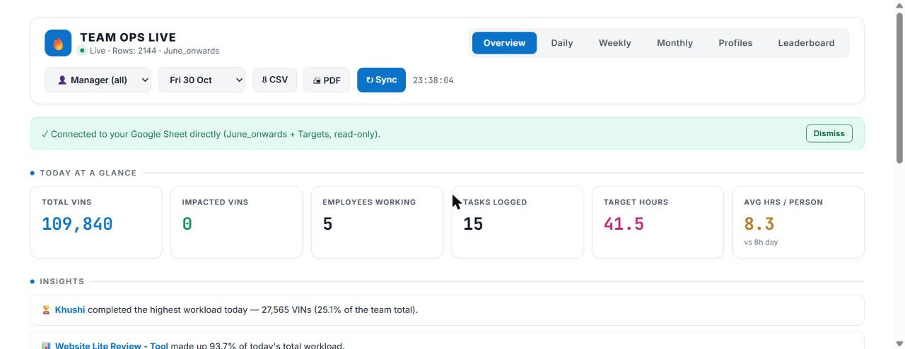
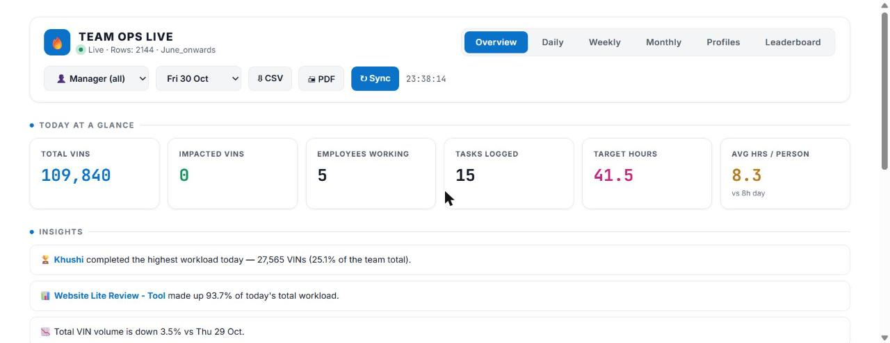
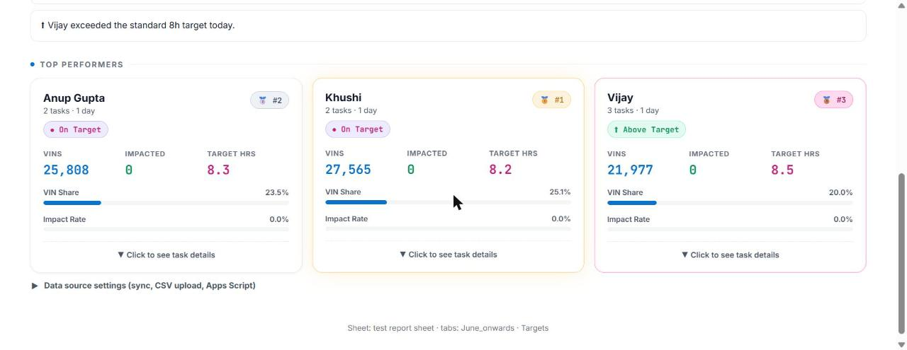
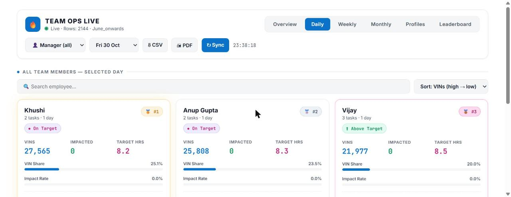
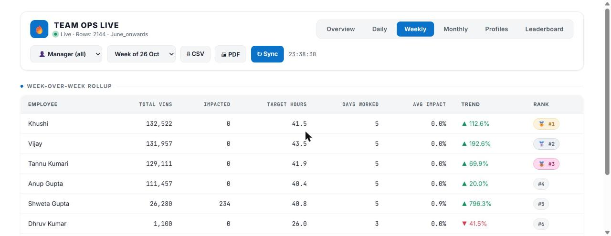
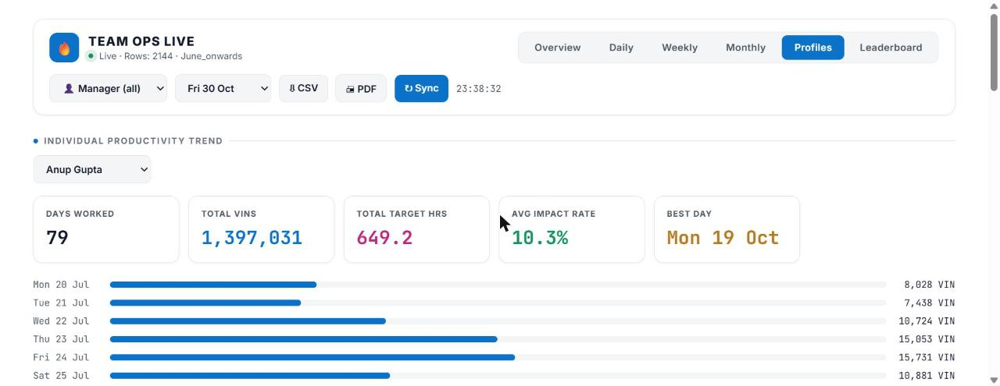
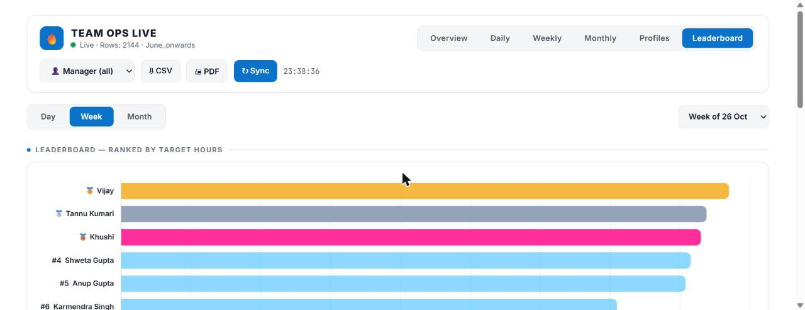
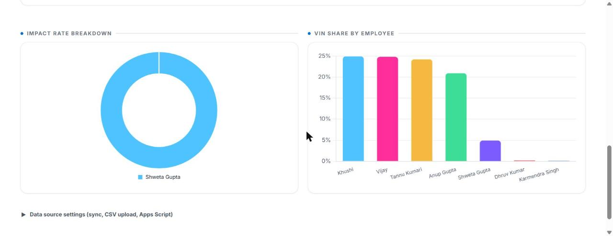
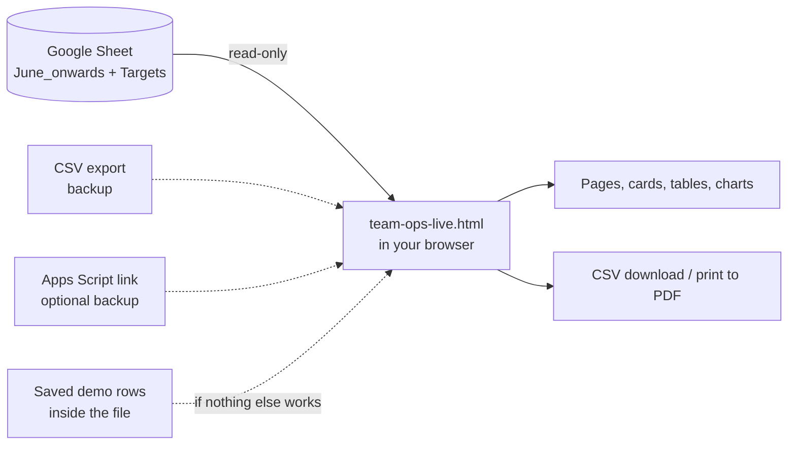
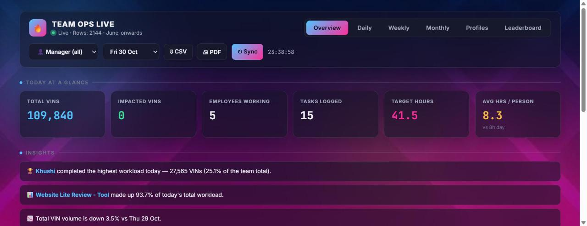

# Team Ops Live: the Catalogue Team's Productivity Dashboard

> **One web page that turns the team's daily work log (a Google Sheet) into a live dashboard**:
> who did how much today, this week and this month, how many working hours that work represents,
> who is above or below the 8-hour target, and how everyone is trending over time.

| | |
|---|---|
| **What it is** | A single file, `team-ops-live.html`, that opens in any web browser |
| **Data source** | Google Sheet *"test report sheet"*, tabs **June_onwards** (the work log) and **Targets** (time per task) |
| **Needs** | A browser and internet. No installation, no server, no login screen, no cost |
| **Pages** | Overview · Daily · Weekly · Monthly · Profiles · Leaderboard |
| **Built with** | HTML, CSS and JavaScript, plus two free libraries: Chart.js (charts) and Papa Parse (CSV files) |
| **Size** | About 1,600 lines of my own code and styling, plus the two libraries bundled inside the same file |
| **Latest change** | Dark pink-and-blue background replaced with a plain white theme (easier to read, prints well, looks professional) |



---

## Contents

1. [Why I built it](#1-why-i-built-it)
2. [What the dashboard shows (screen by screen)](#2-what-the-dashboard-shows-screen-by-screen)
3. [How the numbers are calculated](#3-how-the-numbers-are-calculated)
4. [How it works inside (explained without jargon)](#4-how-it-works-inside-explained-without-jargon)
5. [A walk through the real code](#5-a-walk-through-the-real-code)
6. [How I built it](#6-how-i-built-it)
7. [The white theme change](#7-the-white-theme-change)
8. [How to use it](#8-how-to-use-it)
9. [Limits, privacy and safety](#9-limits-privacy-and-safety)
10. [What could come next](#10-what-could-come-next)
11. [Questions a manager may ask](#11-questions-a-manager-may-ask)
12. [Glossary](#12-glossary)

---

## 1. Why I built it

The catalogue team logs every piece of work in a Google Sheet: the date, who did it, which kind of review it was
(for example *Website Lite Review - Tool*, *QC*, *Console Upload*) and how many VINs (cars) were handled. By
October the **June_onwards** tab had more than **2,100 rows**.

A sheet is good for **recording** work, but bad for **seeing** it:

| Question a lead asks every day | With only the sheet | With the dashboard |
|---|---|---|
| How much did the team do today? | Filter by date, add up columns by hand | First four numbers on the Overview page |
| Who is above or below target? | Look up each task's time, multiply, convert to hours, compare with 8 | A green / purple / red badge on every person |
| Is this week better than last week? | Two filters, two totals, a percentage by hand | ▲ / ▼ arrow with the percentage in the Weekly table |
| How is one person trending? | Copy their rows into another sheet and make a chart | Profiles page: a bar per day, best day, averages |
| Who is the top performer? | Sort, argue about which column matters | Leaderboard ranked by target hours |

Different review types take very different amounts of time. Checking a URL quickly takes 1.5 seconds per VIN; a
deep review takes 60 seconds; a catalog task takes 120 seconds. Counting only VINs is unfair to people doing the
slow, careful work. The dashboard converts every task into **target hours**, which makes different kinds of work
comparable. That is the core idea of the whole tool.

---

## 2. What the dashboard shows (screen by screen)

### 2.1 The top bar (on every page)

| Control | What it does |
|---|---|
| **Status light** | Green "Live · Rows: 2144" = connected to the sheet. Amber "Demo data" = could not connect, showing a saved sample |
| **Page tabs** | Overview, Daily, Weekly, Monthly, Profiles, Leaderboard |
| **Manager (all)** | "View as": the manager sees everyone; choosing a name shows only that person's numbers |
| **Date / week / month picker** | Changes with the page: a day on Overview and Daily, a week on Weekly, a month on Monthly |
| **⇩ CSV** | Downloads the selected day's summary as a spreadsheet file |
| **🖨 PDF** | Opens the print dialog; a special print layout removes buttons so the page prints cleanly |
| **↻ Sync** | Reads the Google Sheet again for fresh numbers |
| **Clock** | Current time, so a screenshot shows when it was taken |

### 2.2 Overview: today at a glance



* **Six headline numbers**: Total VINs, Impacted VINs, Employees Working, Tasks Logged, Target Hours, and
  Average Hours per Person (compared with the 8-hour day). The numbers count up when the page opens.
* **Insights**: sentences the dashboard writes by itself, for example
  *"Khushi completed the highest workload today, 27,565 VINs (25.1% of the team total)"*,
  *"Website Lite Review - Tool made up 93.7% of today's total workload"*,
  *"Total VIN volume is down 3.5% vs Thu 29 Oct"*, and who is above or well below target.
* **Top performers**: the top three people of the day as cards, with the winner in the middle like a podium.



Each person card shows tasks and days, a target badge, VINs, impacted VINs, target hours, their share of the
team's VINs, their impact rate, and **"Click to see task details"**, which lists every review type they did
with VINs and hours.

### 2.3 Daily: every team member on the chosen day



The same cards for everyone, with a **search box** and **sorting** by VINs, impact rate, target hours or name.

### 2.4 Weekly and Monthly: roll-ups with trends



One row per person: total VINs, impacted VINs, target hours, days worked, average impact, **trend** compared with
the previous week or month (▲ green up, ▼ red down, "New" when there was nothing before) and rank with medals
for the top three. Clicking a row opens that person's task breakdown.

### 2.5 Profiles: one person over time



Pick a name to see days worked, total VINs, total target hours, average impact rate, best day, and a bar for
every working day. Good for one-to-one reviews.

### 2.6 Leaderboard and charts



Switch between **Day / Week / Month**. The leaderboard ranks people by **target hours** (gold, silver, bronze for
the top three). Below it: a line chart of VINs over the period, a doughnut chart of who produced the impacted
VINs, and a column chart of each person's share of the VINs.



### 2.7 Data source settings (bottom of every page)

A folded section with two backup ways to load data when the direct sheet connection is blocked: **upload a CSV
export** of the June_onwards tab, or paste an **Apps Script web-app address** (an optional Google-side helper).

---

## 3. How the numbers are calculated

### 3.1 The two tabs it reads

**June_onwards** (one row per piece of work):

| Column the dashboard looks for | Example |
|---|---|
| Date | 30 Oct 2026 |
| Work done by | Khushi |
| Review Type | Website Lite Review - Tool |
| VINs | 912 |
| Impacted VINs | 423 |

**Targets** (how long one VIN of each review type should take, from a start date):

| Review Type | Factor (seconds per VIN) | Start date |
|---|---|---|
| Website Lite Review - Tool | 1.5 | 2026-06-01 |
| Website Deep Review - url | 60 | 2026-06-01 |
| Catalog | 120 | 2026-06-01 |
| Spot QC - Images | 5, then **3** | 2026-06-01, then **2026-07-15** |
| Training | 2,700 | 2026-07-06 |

When a target changes (like *Spot QC - Images* going from 5 to 3 seconds on 15 July), work done before that date
keeps the old value and work after it uses the new one. Old numbers never change when a target is updated.

### 3.2 The formulas

| Number | Formula | Example |
|---|---|---|
| **Target hours** for one row | VINs × seconds per VIN ÷ 3,600 | 912 VINs × 1.5 s ÷ 3,600 = **0.38 h**; 249 VINs × 60 s ÷ 3,600 = **4.15 h** |
| A person's target hours | Sum of all their rows in the period | Khushi on 30 Oct: **8.2 h** |
| **VIN share** | Person's VINs ÷ team VINs × 100 | 27,565 ÷ 109,840 = **25.1 %** |
| **Impact rate** | Impacted VINs ÷ VINs × 100 | 423 ÷ 912 = **46.4 %** |
| Avg hours per person | Team target hours ÷ people who worked | 41.5 ÷ 5 = **8.3 h** |
| **Trend** | (this period − last period) ÷ last period × 100 | Khushi, week of 26 Oct vs the week before: **▲ 112.6 %** |

### 3.3 The target badge

| Badge | Rule | Meaning |
|---|---|---|
| ⬆ **Above Target** (green) | more than 8.4 h (8 h + 5 %) | Did more than a full day's standard work |
| ● **On Target** | 5.6 h to 8.4 h | Normal day |
| ⬇ **Below Target** (red) | less than 5.6 h (70 % of 8 h) | Worth a check-in: maybe a short day, or work not logged |

---

## 4. How it works inside (explained without jargon)

### 4.1 The big picture



Everything happens **inside your browser**. There is no server and no database: the page reads the sheet, does
the maths, and draws the result. Close the tab and nothing is left behind.

### 4.2 What happens when you open the page

1. The browser loads the file: layout (HTML), look (CSS) and logic (JavaScript).
2. The page asks Google for the two tabs (**Sync**). It uses Google's public "visualisation" link for the sheet,
   which works for a sheet that people with the link can view.
3. Google answers with the rows. The page keeps only the five columns it needs and skips incomplete rows.
4. The page reads the Targets tab. If that fails, it uses a built-in copy of the targets.
5. It works out target hours, totals, shares, ranks and trends.
6. It fills the pickers (dates, weeks, months, people) and draws every page.
7. If Google could not be reached within 7 seconds, it shows a real saved sample (15 to 17 June) and an amber
   message, so the page is never blank.

### 4.3 Ten words that explain the inside

| Word | Plain meaning | Everyday comparison |
|---|---|---|
| **HTML** | The structure: headings, buttons, tables | The walls and rooms of a house |
| **CSS** | The look: colours, spacing, fonts | Paint and furniture |
| **JavaScript** | The behaviour: fetch data, calculate, react to clicks | Electricity and plumbing |
| **Browser** | Chrome, Edge ... the program that runs all three | The house itself |
| **Function** | A named recipe of steps the code can reuse | "Make tea" written once, used many times |
| **Variable** | A labelled box that holds a value | A jar with a label |
| **Array / list** | An ordered list of values, e.g. all rows | A register with numbered lines |
| **Library** | Ready-made code written by others | Buying a ready-made cupboard |
| **JSONP / gviz** | A way to read a public Google Sheet from a web page | Asking the librarian for a photocopy |
| **CSV** | A plain spreadsheet file Excel can open | A table written in a notebook with commas |

---

## 5. A walk through the real code

The file has three parts: **styles** (lines 9–320), **page layout** (lines 322–480), the two **libraries**
(Papa Parse and Chart.js, bundled as-is), and **my logic** (lines 500–1,608). Here are the most important pieces,
each with a plain-English explanation.

### 5.1 Where the data lives

```js
const SHEET_ID = '1QjVtoiRR7hbxKxpv5-KWRzckbcFvNTI7ewkG3X-PWjU'; // "test report sheet"
const DATA_SHEET_NAME = 'June_onwards';
const TARGET_SHEET_NAME = 'Targets';
```

`const` creates a value that never changes. These three lines tell the page which Google Sheet and which tabs
to read. To point the dashboard at another sheet, only these lines change.

### 5.2 Picking the right target for a date

```js
function getFactor(reviewType, dateStr){
  const cands = factors.filter(f=>f.reviewType===reviewType && f.startDate<=dateStr);
  if(cands.length){
    cands.sort((a,b)=> a.startDate<b.startDate?1:-1);
    return cands[0].factor;
  }
  const any = factors.filter(f=>f.reviewType===reviewType);
  return any.length ? any[0].factor : 0;
}
```

| Line | In plain English |
|---|---|
| `function getFactor(reviewType, dateStr)` | A recipe that answers: "how many seconds per VIN for this kind of review on this date?" |
| `factors.filter(...)` | From the Targets list keep only rows for this review type whose start date is on or before the work date |
| `cands.sort(...)` | Put the most recent start date first |
| `return cands[0].factor` | Use the newest target that was already valid on that day |
| the last two lines | If nothing matched (e.g. work dated before any target), use any target for that type, or 0 |

This is what makes target changes fair: work from June uses June's target, work from August uses August's.

### 5.3 Adding everything up per person

```js
function aggregate(filterRows){
  const byEmp = {};
  filterRows.forEach(r=>{
    if(!byEmp[r.employee]) byEmp[r.employee] = {employee:r.employee, vins:0, impacted:0, hours:0, tasks:0, byType:{}, days:new Set()};
    const e = byEmp[r.employee];
    e.vins += r.vins;
    e.impacted += r.impacted;
    const f = getFactor(r.reviewType, r.date);
    const h = (r.vins * f)/3600;
    e.hours += h;
    ...
  });
  ...
  list.sort((a,b)=>b.vins-a.vins);
  list.forEach((e,i)=>e.rank=i+1);
  return {list, totalVins};
}
```

* `byEmp` is a notebook with one page per person.
* `forEach` goes through every work row once. The first time a name appears, a new page is started.
* For each row it adds VINs and impacted VINs, looks up the target with `getFactor`, turns it into hours
  (`× seconds ÷ 3600`) and adds that too. It also remembers per review type for the "task details" list,
  and which dates the person worked (`Set` keeps each date only once, so "days worked" is correct).
* At the end it sorts people by VINs and numbers them 1, 2, 3 ... for the rank.

Every page (Overview, Daily, Weekly, Monthly, Leaderboard) uses this same function on a different set of rows:
one day, one week or one month. One calculation, used everywhere, means the numbers always agree.

### 5.4 Reading the Google Sheet

```js
function fetchGviz(sheetNameOrGid, isGid){
  return new Promise((resolve,reject)=>{
    const cb = 'gviz_'+...+'_'+Math.floor(Math.random()*1e9);
    const timer = setTimeout(()=>{ cleanup(); reject(new Error('timeout')); },7000);
    window[cb] = (resp)=>{ cleanup(); resolve(resp); };
    const s = document.createElement('script');
    s.src = `https://docs.google.com/spreadsheets/d/${SHEET_ID}/gviz/tq?${param}&tqx=out:json;responseHandler:${cb}`;
    document.body.appendChild(s);
  });
}
```

Browsers normally do not let one website read another website's data. Google offers a workaround for public
sheets: you ask for the sheet as a small script, and Google's answer calls a function you named (`cb`). The code:

1. makes up a unique function name,
2. starts a 7-second stopwatch (no answer in time = give up and use the backup),
3. adds a `<script>` tag pointing at Google's address for that tab,
4. when Google's answer arrives, it calls the function, which hands the rows back and cleans up.

A `Promise` is JavaScript's way of saying "I will give you the answer later"; `await` waits for it.

### 5.5 Never showing a blank page

```js
async function attemptSync(){
  dot.className = 'dot syncing';
  try{
    await loadLive();
    render();
  }catch(err){
    console.warn('Live sync failed:', err.message);
    loadDemo();
    render();
  }
}
```

`try` / `catch` means "try the live sheet; if anything goes wrong, catch the problem and load the saved sample
instead". The user always sees a working page and a clear message about which data is shown.

### 5.6 Insights written by the code

```js
const above = list.filter(e=>e.hours > 8*1.05).map(e=>e.employee);
const below = list.filter(e=>e.hours < 8*0.7).map(e=>e.employee);
if(above.length) insights.push(`⬆ ${above.join(', ')} exceeded the standard 8h target today.`);
if(below.length) insights.push(`⬇ ${below.join(', ')} logged well under target hours — worth a check-in.`);
```

`filter` keeps the people who match a rule, `map` takes just their names, `join` writes them as "A, B, C", and the
text between back-ticks is a sentence template with the names filled in. The other insights (top performer,
biggest task type, change vs the previous day) are built the same way.

### 5.7 Drawing a chart

```js
leaderboardChartInstance = new Chart(canvas.getContext('2d'), {
  type:'bar',
  data:{ labels, datasets:[{ label:'Target Hours', data, backgroundColor:colors, borderRadius:8 }] },
  options:{ indexAxis:'y', ... }
});
```

Chart.js draws the chart; the code only describes it: a bar chart, names as labels, target hours as values,
gold / silver / bronze colours for the top three, and `indexAxis:'y'` to make the bars horizontal. Before a new
chart is drawn, the old one is removed (`destroy()`), so switching Day / Week / Month never stacks charts.

### 5.8 Downloading a CSV

```js
const blob = new Blob([lines.join('\n')], {type:'text/csv'});
const url = URL.createObjectURL(blob);
const a = document.createElement('a');
a.href = url; a.download = `team-ops-${selectedDate||'export'}.csv`;
a.click();
```

The page writes the table as text with commas, wraps it as a file in memory (`Blob`), makes a temporary link to
it and clicks that link for you, which makes the browser download `team-ops-2026-10-30.csv`.

---

## 6. How I built it

I come from catalogue operations, not from a computer-science background. I know this work from the inside:
the review types, how long each takes, what a good day looks like. I built the dashboard by combining that
knowledge with an **AI coding assistant**, which writes code from instructions in plain language.

### 6.1 Who did what

| I did | The AI assistant did |
|---|---|
| Defined what the team lead needs to see every day | Wrote the HTML, CSS and JavaScript |
| Designed the "target hours" idea and the 8-hour rules | Turned the rules into formulas and code |
| Gave the real sheet, tab names and target table | Wrote the sheet reader and the CSV / demo backups |
| Checked every number against the sheet by hand | Fixed issues I reported |
| Decided the pages, the order and the look (including the move to white) | Applied design changes across the whole file |
| Tested on real data with real team members' rows | Explained the code to me so I can maintain it |

### 6.2 The steps

1. **Start from the question**, not the tool: "who is above target today and why?"
2. **Fix the data shape**: the five columns the log must have, and the Targets tab with start dates.
3. **One calculation, used everywhere** (`aggregate`), so every page agrees.
4. **Build page by page**: Overview first (what a lead opens every morning), then Daily, Weekly, Monthly,
   Profiles, and last the Leaderboard with charts.
5. **Plan for failure**: timeouts, a CSV upload, an optional Apps Script link, and a saved sample, so the page is
   never empty.
6. **Make it shareable**: CSV export and a clean print layout for PDF.
7. **Polish**: animations, medals, insights in plain sentences, and now a clean white theme.
8. **Version it**: the project is in Git, so every change can be seen and undone.

### 6.3 What I learned

* How a web page is built from HTML, CSS and JavaScript, and how to read each of them.
* How data gets from a Google Sheet into a page, and why browsers block some requests.
* How to turn a business rule ("8 hours a day, targets per task, changing over time") into exact formulas.
* How to design for failure, so a tool never leaves people with an empty screen.
* How to use Git and GitHub to keep versions and share work safely.

---

## 7. The white theme change

| Before (dark, pink and blue) | After (plain white) |
|---|---|
|  |  |

What changed, only in the look, not in any number:

* The **background photo with a pink-and-blue overlay** and the three **floating coloured glows** are gone. The
  page is plain white, which also makes the file 14 KB smaller.
* Cards and tables are white with a thin grey border and a soft shadow.
* Text is dark grey or near-black for easy reading. Accent colours (blue, green, amber, pink) were darkened so
  they stay readable on white.
* Active tabs, the Sync button and progress bars are **solid blue** instead of a pink-to-blue gradient.
* Chart labels and grid lines are dark so they show on white.
* The original dark version is kept in the Git history (first commit), so it can be brought back at any time.

---

## 8. How to use it

1. Download `team-ops-live.html` (or the whole repository) and double-click the file. It opens in your browser.
2. Wait 2 to 5 seconds. A green **Live** light means the numbers come straight from the sheet.
3. Pick a page at the top, and a day, week or month on the right.
4. To share: **⇩ CSV** for the numbers, **🖨 PDF** for a printable page.
5. If you see an amber **Demo data** message, press **↻ Sync**. If it still fails, open *Data source settings* at
   the bottom and upload a CSV export of the June_onwards tab.

**Keeping the data right**

* Keep the column names in June_onwards exactly as they are: `Date`, `Work done by`, `Review Type`, `VINs`,
  `Impacted VINs`.
* When a target changes, **add a new row** in Targets with the new start date. Do not edit the old row, so past
  days keep their original target.
* Write names the same way every time ("Tannu Kumari", not sometimes "Tannu"), or the person appears twice.

---

## 9. Limits, privacy and safety

* **Read-only.** The dashboard only reads the sheet. It cannot change or delete anything in it.
* **The sheet must be viewable by link** for the live connection to work. That also means anyone who has the
  sheet's link can open it. Keep the link inside the team.
* **People's names and work numbers** are in the sheet and in the small saved sample inside the file. The
  repository is **private** for that reason; do not make it public.
* **Nothing is stored.** No database, no cookies, no tracking. Closing the tab clears everything.
* **Internet needed** for live data. Without it, the saved sample (15–17 June) is shown, clearly labelled.
* **One sheet.** The sheet and tab names are written in the code (section 5.1).

---

## 10. What could come next

| Idea | Benefit | Effort |
|---|---|---|
| Host the page on an internal link (e.g. a private GitHub Pages site or a shared drive) | Everyone opens the same link, no file to send around | Small |
| Daily e-mail of the Overview as a PDF | Leads get the numbers without opening anything | Medium |
| Per-person targets (e.g. new joiners on 6 h) | Fairer badges during training | Small |
| Quality next to quantity (QC rejections per person) | Rewards careful work, not only volume | Medium |
| Alerts when someone is below target two days in a row | Earlier support for the person | Small |

---

## 11. Questions a manager may ask

**Is it accurate?**
It uses exactly the sheet's numbers and the team's own target table. Every formula is in section 3, so any number
can be checked against the sheet by hand. One calculation is used by every page, so the pages always agree.

**Can it change our data by mistake?**
No. It only reads. There is no button or code that writes to the sheet.

**Who can see it?**
Whoever has the file and the sheet's link. The code repository is private.

**What does it cost?**
Nothing. It is one file opened in a browser, reading a sheet we already have.

**What if the sheet's columns change?**
The page looks for the column names (not positions). If a name changes, the page shows the saved sample and the
message says live sync failed; updating one line in the code (section 5.1 / 3.1) fixes it.

**Why target hours and not just VINs?**
A deep review takes 40 times longer per VIN than a quick check. Counting VINs alone would rank the fastest task
highest, not the hardest-working person. Target hours make different work comparable.

**You are not from tech. Can you maintain it?**
Yes. I designed every rule and page, tested every number, and can read and explain each part of the code (section
5). The AI assistant speeds up the typing; the decisions, checks and ownership are mine.

---

## 12. Glossary

| Word | Meaning |
|---|---|
| **Target hours** | Standard time the logged work should take: VINs × seconds per VIN ÷ 3,600 |
| **Factor** | Seconds per VIN for one review type, from the Targets tab |
| **Impacted VINs** | VINs where the review found and changed something |
| **Impact rate** | Impacted VINs ÷ VINs, as a percentage |
| **VIN share** | One person's VINs as a percentage of the team's VINs |
| **Roll-up** | Adding many rows into one total (per week, per month) |
| **Sync** | Reading the Google Sheet again |
| **Demo data** | A saved real sample (15–17 June) shown when the sheet can't be reached |
| **CSV** | A plain spreadsheet file Excel and Google Sheets can open |
| **Chart.js / Papa Parse** | Free libraries for drawing charts / reading CSV files |
| **Git / GitHub** | Version history of the code / the website that stores it privately |
| **Repository (repo)** | One project's folder on GitHub, with its full history |

---

*Team Ops Live · Catalogue Team, Spyne · built by Karmendra Singh*
